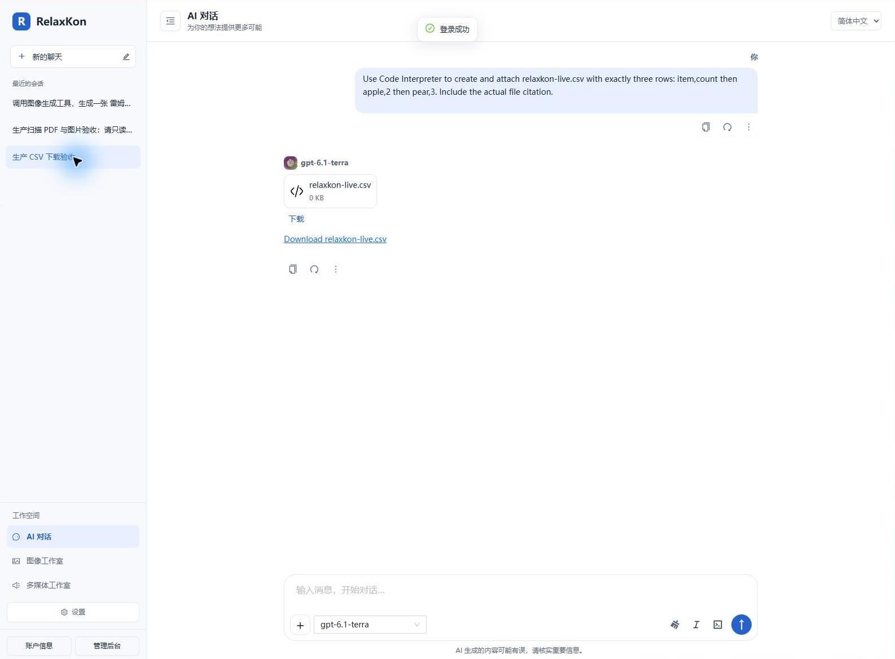
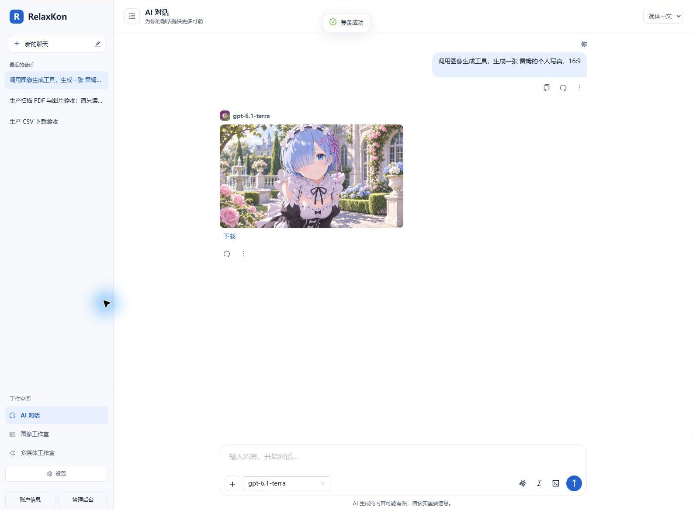
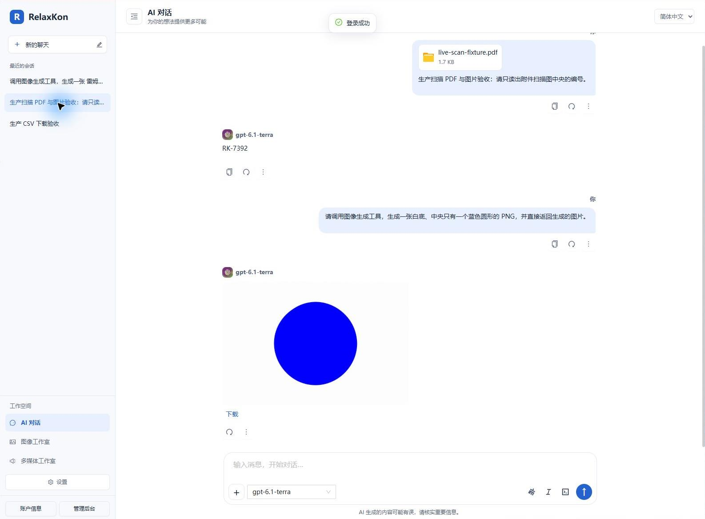

# RelaxKon Web

RelaxKon Web是一个 Angular 单页应用，用于访问 RelaxKon Server 提供的聊天、图像生成和音频处理能力。它是原 `turbo-user` 的渐进式更名，已合并原 `turbo-admin`，同时包含用户对话界面与管理员后台，不是新项目。

服务端仓库对应更名为 [`relaxkon-server`](https://github.com/nanaminato/relaxkon-server)。现有 Git 历史、账户、数据库与 API 保持兼容。更名与部署检查见 [安全迁移指南](docs/relaxkon-migration.md)。

## 你想做什么？

| 目标 | 从这里开始 |
| --- | --- |
| 使用聊天、图像或音频工具 | [用户指南](docs/user-guide.md) |
| 查看架构与实施记录 | [前端架构](docs/architecture.md) · [架构审查](docs/architecture-review.md) |
| 注册并验证邮箱 | [邮箱验证](docs/registration-email-verification.md) |
| 对照后端接口与类型 | [API 契约](docs/api-contracts.md) |
| 在本机运行或参与开发 | [开发指南](docs/development.md) |
| 配置后端、账户、模型与密钥 | [RelaxKon Server 文档](https://github.com/nanaminato/relaxkon-server/tree/master/docs) |

## 功能概览

- 流式 AI 聊天，支持会话历史、系统提示词、Markdown、代码与文件上下文。
- 图像工作室，可使用后端已启用的 OpenAI 或 APIMart 图像模型。
- 多媒体工作室，提供文本转语音、语音转写、语音翻译与文件文本提取。
- 管理员后台支持账户、稳定编码角色、模型、供应商密钥与按角色配置的功能权限和请求配额。
- 本地保存显示偏好、常用模型与会话设置；账户登录后可使用服务端提供的同步能力。
- 支持中文、英文和日文，以及响应式页面与离线资源缓存。

## 生产环境截图

以下示例截自 [RelaxKon 生产站点](https://relaxkon.com/chat) 的 AI 对话。

### 在对话中生成文件

模型按提示生成 CSV，并在回复中提供文件卡片和下载链接。可直接打开 [生成的 CSV 示例](docs/examples/relaxkon-live.csv)。



### 在对话中生成图像

生成的图像直接显示在模型回复中，可以从对话下载。



### 在对话中发送文件

用户随消息发送扫描版 PDF，模型读取附件并返回扫描图上的编号。可直接打开 [对话中发送的 PDF 示例](docs/examples/live-scan-fixture.pdf)。



## 快速开始

已部署的站点无需安装任何软件：使用管理员提供的地址注册或登录，选择可用模型后即可开始对话。若页面提示没有可用模型或无权调用功能，请联系管理员完成账户角色、模型和供应商密钥配置。

开发环境请先准备一个可访问的 RelaxKon Server，再执行：

```bash
npm ci
npm start
```

默认开发地址与后端地址配置见 [开发指南](docs/development.md)。

## 维护原则

- 本仓库不保存供应商 API 密钥、数据库密码或生产令牌。
- 生产环境将前端部署到后端站点根目录，使用同源根路径 `/` 调用 API。
- 文档中的接口、角色和服务端配置以 RelaxKon Server 的 Swagger 与服务端文档为准。

## Authentication security

See [authentication security administration](docs/auth-security.md) for the admin editor, live permissions, default limits and login throttling behavior.
